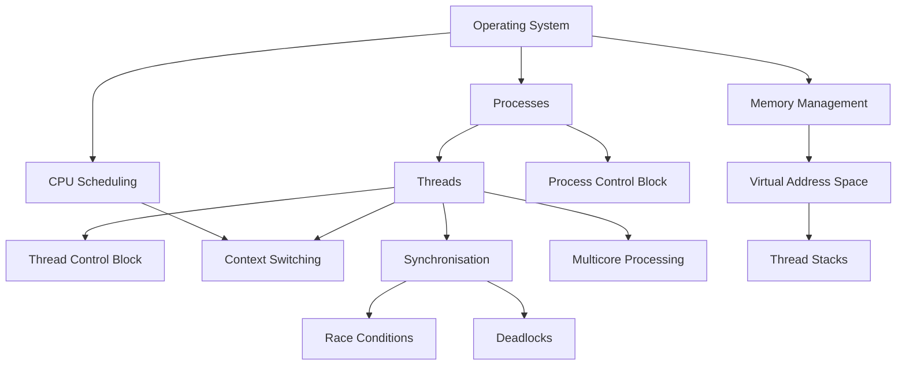

<section id="threads-practical-applications-and-revision" class="concept-section" aria-labelledby="threads-section-10-heading">

  <h2 id="threads-section-10-heading">10. Practical Applications</h2>

  <h3>10.1 Threads in Real-World Applications</h3>

  
Threads are used in many applications to help perform multiple tasks and keep software responsive.

  
Here are some practical examples.

  <h4>10.1.1 Web Browsers</h4>

  
A modern web browser may use multiple processes and threads to manage different activities.

  
Threads can help with:

  <ul>
    <li>Responding to user interactions.</li>
    <li>Processing background tasks.</li>
    <li>Handling network-related work.</li>
    <li>Updating parts of the interface.</li>
    <li>Performing other application activities.</li>
  </ul>

  
<strong>Why are threads useful?</strong>

  
They help prevent a lengthy background task from unnecessarily stopping all other application activity.

  
The exact browser architecture varies. Modern browsers often use several processes as well as multiple threads within those processes.

  <h4>10.1.2 Video Editing Applications</h4>

  
A video editing application may use threads for:

  <ul>
    <li>Processing video frames.</li>
    <li>Applying visual effects.</li>
    <li>Processing audio.</li>
    <li>Rendering previews.</li>
    <li>Exporting video.</li>
  </ul>

  
<strong>Why are threads useful?</strong>

  
Different parts of a video-processing workload may be handled concurrently. Suitable workloads can also benefit from parallel execution across multiple CPU cores.

  <h4>10.1.3 Music Applications</h4>

  
A music application may use threads to help manage:

  <ul>
    <li>Audio playback.</li>
    <li>User-interface interactions.</li>
    <li>Music downloads.</li>
    <li>Background processing.</li>
    <li>Audio decoding.</li>
  </ul>

  
<strong>Why are threads useful?</strong>

  
The application can continue responding to the user while other tasks take place.

  
Real-time audio work also has timing requirements, so thread scheduling and delays must be carefully managed.

  <h4>10.1.4 Web Servers</h4>

  
A web server may use multiple threads to handle incoming requests.

  
For example:

  <ol>
    <li>A request arrives from a user.</li>
    <li>The server assigns work to an available thread or worker.</li>
    <li>The thread processes the request.</li>
    <li>It accesses required data or services.</li>
    <li>It prepares and sends a response.</li>
  </ol>

  
Some servers use thread pools, where a group of worker threads is reused to handle multiple tasks.

  
<strong>Why are threads useful?</strong>

  
They can help a server handle multiple requests without creating a completely separate process for every task.

  <h4>10.1.5 Computer Games</h4>

  
A game may use threads for different activities, such as:

  <ul>
    <li>Game logic.</li>
    <li>Physics calculations.</li>
    <li>Audio processing.</li>
    <li>Asset loading.</li>
    <li>Background tasks.</li>
  </ul>

  
<strong>Why are threads useful?</strong>

  
They can help distribute work and maintain a responsive gaming experience.

  
However, game engines must coordinate these activities carefully because some tasks depend on the results of others.

  <h4>Practical application summary</h4>

  <table>
    <thead>
      <tr>
        <th scope="col">Application</th>
        <th scope="col">Possible thread activities</th>
      </tr>
    </thead>
    <tbody>
      <tr>
        <td>Web browser</td>
        <td>Interface, networking and background work</td>
      </tr>
      <tr>
        <td>Video editor</td>
        <td>Video, audio and rendering tasks</td>
      </tr>
      <tr>
        <td>Music application</td>
        <td>Playback, downloads and interface</td>
      </tr>
      <tr>
        <td>Web server</td>
        <td>Processing incoming requests</td>
      </tr>
      <tr>
        <td>Computer game</td>
        <td>Game logic, physics and audio</td>
      </tr>
    </tbody>
  </table>

  
These are illustrative examples. Real applications may combine threads, processes, asynchronous operations and other execution models.

  <h2 id="threads-section-11-heading">11. Common Mistakes and Misunderstandings</h2>

  
Understanding what threads are is important. Understanding what they are not is equally important.

  <h4>Mistake 1 — A Program and a Process Are the Same Thing</h4>

  
<strong>Incorrect:</strong> A program and a process are identical.

  
<strong>Correct:</strong> A program is a set of instructions. A process is an executing instance of a program, with its own process environment and resources.

  <h4>Mistake 2 — A Thread Is a Separate Process</h4>

  
<strong>Incorrect:</strong> Every thread is an independent process.

  
<strong>Correct:</strong> A thread is an execution path within a process. Threads in the same process commonly share process resources.

  <h4>Mistake 3 — Threads Have Their Own Completely Separate Memory</h4>

  
<strong>Incorrect:</strong> Every thread has its own independent copy of all process memory.

  
<strong>Correct:</strong> Threads share many process resources, including code, global data and heap memory. Each thread has its own execution context, including its stack and CPU registers.

  <h4>Mistake 4 — Concurrency Always Means Parallelism</h4>

  
<strong>Incorrect:</strong> If two tasks are concurrent, they must be executing simultaneously.

  
<strong>Correct:</strong> Concurrent tasks can make progress during overlapping periods. They may take turns on one CPU core. Parallel tasks execute simultaneously on separate processing resources.

  <h4>Mistake 5 — A Ready Thread Is Running</h4>

  
<strong>Incorrect:</strong> A thread in the Ready state is already executing.

  
<strong>Correct:</strong> It is eligible to run but is waiting for CPU time.

  <h4>Mistake 6 — More Threads Always Make a Program Faster</h4>

  
<strong>Incorrect:</strong> Adding more threads always improves performance.

  
<strong>Correct:</strong> Too many threads can increase scheduling overhead, memory use and contention. Some workloads cannot be divided efficiently.

  <h4>Mistake 7 — Shared Data Is Automatically Safe</h4>

  
<strong>Incorrect:</strong> Threads can safely modify shared data simply because they belong to the same process.

  
<strong>Correct:</strong> Shared data requires appropriate coordination. Unsynchronised access can produce race conditions.

  <h4>Mistake 8 — A Mutex Solves Every Synchronisation Problem</h4>

  
<strong>Incorrect:</strong> Using a mutex automatically makes an entire application thread-safe.

  
<strong>Correct:</strong> A mutex protects a particular critical section when used correctly. Poor locking design can still cause deadlocks, starvation or other problems.

  <h2 id="threads-section-12-heading">12. Limitations, Synchronisation and Troubleshooting</h2>

  
Threads offer important benefits, but they also introduce challenges.

  <h3>12.1 Race Conditions</h3>

  
A race condition occurs when the result of concurrent operations depends on their timing or ordering.

  
<strong>Example:</strong> Two threads attempt to update the same bank account balance.

  
If both read the same old value before either writes its update, one update may be lost.

  
<strong>Possible solution:</strong> Use appropriate synchronisation, such as a mutex or an atomic operation, depending on the data and operation involved.

  <h3>12.2 Critical Sections</h3>

  
A critical section is a part of a program that accesses shared data or resources requiring coordinated access.

  
If multiple threads modify the same shared data without suitable protection, the results may become incorrect.

  
<strong>Possible solution:</strong> Protect the critical section using an appropriate synchronisation mechanism.

  <h4>10.3.3 Mutexes</h4>

  
A mutex, or mutual-exclusion lock, allows one thread at a time to enter a protected critical section.

  
A simplified pattern is:

  <ol>
    <li>Acquire the mutex.</li>
    <li>Access or update the protected shared resource.</li>
    <li>Release the mutex.</li>
  </ol>

  

    
<strong>Important:</strong> All relevant accesses must follow the same locking discipline. A mutex does not protect data from code that accesses it without acquiring the lock.

  

  <h4>10.3.4 Semaphores</h4>

  
A semaphore is a synchronisation mechanism that uses a counter to control access to resources or coordinate activities.

  
Two common forms are:

  <ul>
    <li><strong>Binary semaphore:</strong> Uses a value representing two states, commonly 0 and 1.</li>
    <li><strong>Counting semaphore:</strong> Tracks a number of available resource permits or signals.</li>
  </ul>

  
A semaphore can be useful when a program needs to control access to a limited number of resources.

  
A semaphore and a mutex are related synchronisation tools, but they are not interchangeable in every situation. A mutex generally has ownership semantics: the thread that acquires it is expected to release it.

  <h4>10.3.5 Condition Variables</h4>

  
A condition variable allows threads to wait until a particular condition becomes true.

  
It is commonly used together with a mutex.

  
For example, a worker thread may wait until a queue contains work. When another thread adds an item, it can notify the waiting thread.

  
The waiting thread wakes and checks the condition again while following the required locking protocol.

  <h4>10.3.6 Atomic Operations</h4>

  
An atomic operation is performed as an indivisible operation from the perspective of other threads.

  
For example, an atomic counter increment can prevent the lost-update problem associated with an unsafe read-modify-write sequence.

  
Atomic operations are useful for certain shared-data problems, but they do not automatically make every multi-step operation safe.

  <h4>10.3.7 Deadlocks</h4>

  
A deadlock occurs when two or more threads become permanently blocked because each is waiting for a resource held by another.

  
The four classic Coffman conditions are:

  <ol>
    <li><strong>Mutual Exclusion:</strong> At least one resource cannot be shared simultaneously.</li>
    <li><strong>Hold and Wait:</strong> A thread holds one resource while waiting for another.</li>
    <li><strong>No Pre-emption:</strong> Resources cannot simply be taken away; they must be released voluntarily.</li>
    <li><strong>Circular Wait:</strong> A circular chain of threads exists, with each waiting for a resource held by the next.</li>
  </ol>

  
All four conditions must hold for a deadlock to occur under this classic model.

  
<strong>Possible prevention approaches:</strong>

  <ul>
    <li>Establish a consistent lock-acquisition order.</li>
    <li>Avoid holding locks longer than necessary.</li>
    <li>Design resource allocation carefully.</li>
    <li>Use suitable timeout or recovery strategies where appropriate.</li>
  </ul>

  <h4>10.3.8 Starvation</h4>

  
Starvation occurs when a thread waits for a very long time, or indefinitely, because it repeatedly fails to obtain the resources or CPU time it needs.

  
For example, a low-priority thread may continually be overlooked when higher-priority threads keep becoming eligible to run.

  
<strong>Possible approaches:</strong>

  <ul>
    <li>Fair scheduling policies.</li>
    <li>Priority adjustment or priority aging.</li>
    <li>Fair resource-access mechanisms.</li>
  </ul>

  
The effectiveness of these approaches depends on the operating system and application design.

  <h4>10.3.9 Thread Safety</h4>

  
Thread safety means that a component behaves correctly when accessed by multiple threads according to its intended usage rules.

  
A thread-safe component may use:

  <ul>
    <li>Mutexes.</li>
    <li>Atomic operations.</li>
    <li>Immutable data.</li>
    <li>Carefully designed concurrent data structures.</li>
    <li>Other synchronisation techniques.</li>
  </ul>

  
Thread safety is a property of the implementation and its usage, not simply a result of using multiple threads.

  <h4>10.3.10 Overhead and Resource Contention</h4>

  
Threads are not free.

  
They may require:

  <ul>
    <li>Memory for stacks and management information.</li>
    <li>Scheduling and context-switching work.</li>
    <li>Synchronisation operations.</li>
    <li>Coordination between CPU cores.</li>
  </ul>

  
Too many threads competing for the same CPU, memory or locks can reduce performance.

  <h4>10.3.11 Troubleshooting Guide</h4>

  <table>
    <thead>
      <tr>
        <th scope="col">Problem</th>
        <th scope="col">Possible reason</th>
        <th scope="col">What to investigate</th>
      </tr>
    </thead>
    <tbody>
      <tr>
        <td>Incorrect shared-data results</td>
        <td>Race condition</td>
        <td>Check concurrent reads and writes</td>
      </tr>
      <tr>
        <td>Application becomes unresponsive</td>
        <td>Blocked thread or long-running work</td>
        <td>Identify what the thread is waiting for</td>
      </tr>
      <tr>
        <td>Threads remain waiting indefinitely</td>
        <td>Deadlock</td>
        <td>Examine lock ownership and acquisition order</td>
      </tr>
      <tr>
        <td>One thread rarely makes progress</td>
        <td>Starvation</td>
        <td>Examine scheduling and resource fairness</td>
      </tr>
      <tr>
        <td>Performance becomes slower</td>
        <td>Too many threads or contention</td>
        <td>Review workload and thread count</td>
      </tr>
      <tr>
        <td>Unexpected data changes</td>
        <td>Missing synchronisation</td>
        <td>Check all accesses to shared data</td>
      </tr>
      <tr>
        <td>High CPU usage</td>
        <td>Busy waiting or excessive work</td>
        <td>Examine loops, scheduling and workload</td>
      </tr>
    </tbody>
  </table>

  

    
<strong>Remember:</strong> Adding threads introduces coordination responsibilities. Correct synchronisation and careful design are essential.

  

  <h3>10.4 Connections to Other Operating-System Concepts</h3>

  
Threads are closely connected to several other operating-system topics.

  
Understanding these relationships helps build a complete picture of how an operating system manages execution.

  <h4>10.4.1 Operating Systems</h4>

  
The operating system manages processes, threads, memory, devices and other resources.

  
Threads are one of the mechanisms through which programs perform work.

  <h4>10.4.2 Programs</h4>

  
A program contains instructions.

  
When a program is executed, the operating system creates or manages an execution environment in which processes and threads can operate.

  <h4>10.4.3 Processes</h4>

  
A process is an executing program instance with its own resource environment.

  
A process can contain one or more threads.

  
Threads within the same process commonly share many resources.

  <h4>10.4.4 Process Control Block (PCB)</h4>

  
A Process Control Block is a conceptual operating-system data structure containing information used to manage a process.

  
Depending on the operating system, this may include process identification, state, resource and memory-management information.

  <h4>10.4.5 Thread Control Block (TCB)</h4>

  
A Thread Control Block is a conceptual term for information maintained to manage an individual thread.

  
It may represent information such as thread state, scheduling information and execution context.

  
The exact names and structures vary between operating systems.

  <h4>10.4.6 CPU Scheduling</h4>

  
CPU scheduling determines which eligible thread or execution entity should receive CPU time.

  
The scheduler helps share processing resources among competing work.

  <h4>10.4.7 Context Switching</h4>

  
Context switching allows CPU execution to move from one thread to another.

  
The necessary execution context is saved and restored so that threads can resume their work.

  <h4>10.4.8 Memory Management</h4>

  
Threads share many parts of their process’s virtual address space.

  
Each thread also requires its own stack and execution context.

  
Memory management therefore plays an important role in supporting multithreaded processes.

  <h4>10.4.9 Synchronisation</h4>

  
Synchronisation coordinates access to shared resources and helps ensure that concurrent operations produce correct results.

  
Mutexes, semaphores, condition variables and atomic operations are examples of related mechanisms.

  <h4>10.4.10 Race Conditions</h4>

  
Race conditions demonstrate why shared-data access must be designed carefully.

  
They connect thread management with synchronisation, critical sections and thread safety.

  <h4>10.4.11 Deadlocks</h4>

  
Deadlocks can arise when threads wait for resources held by one another.

  
They connect thread synchronisation with resource allocation and operating-system resource management.

  <h4>10.4.12 Multicore Processing</h4>

  
A multicore processor contains multiple CPU cores.

  
Suitable threads may execute simultaneously on different cores, allowing parallel processing.

  <h4>Related concept map</h4>

  <h4>Concept connection summary</h4>

  
Threads connect multiple important areas of operating systems:

  <ul>
    <li>Process management explains where threads belong.</li>
    <li>Scheduling explains how they receive CPU time.</li>
    <li>Context switching explains how execution moves between them.</li>
    <li>Memory management explains shared address spaces and individual stacks.</li>
    <li>Synchronisation explains how threads coordinate.</li>
    <li>Deadlock and race-condition concepts explain what can go wrong.</li>
    <li>Multicore processing explains how parallel execution can occur.</li>
  </ul>

  <h3>10.5 Assessment — Test Your Understanding</h3>

  
Answer the following twelve questions to check your understanding of threads.

  <h4>Question 1 — What is a thread?</h4>

  <ol type="A">
    <li>A complete computer program stored on disk.</li>
    <li>A path of execution within a process.</li>
    <li>A separate physical CPU.</li>
    <li>A type of storage device.</li>
  </ol>

  
<strong>Correct answer: B</strong>

  
<strong>Explanation:</strong> A thread is an execution path within a process. It has its own execution context and uses the resources of its process.

  <h4>Question 2 — What is commonly shared by threads in the same process?</h4>

  <ol type="A">
    <li>Their individual program counters.</li>
    <li>Their individual CPU registers.</li>
    <li>Their process’s heap memory.</li>
    <li>Their individual stacks.</li>
  </ol>

  
<strong>Correct answer: C</strong>

  
<strong>Explanation:</strong> Threads in the same process commonly share heap memory, code, global data and other process resources. Their execution contexts remain individual.

  <h4>Question 3 — Which component is individual to each thread?</h4>

  <ol type="A">
    <li>Program code.</li>
    <li>Global variables.</li>
    <li>Heap memory.</li>
    <li>Program counter.</li>
  </ol>

  
<strong>Correct answer: D</strong>

  
<strong>Explanation:</strong> Each thread maintains its own program counter so it can keep track of its own execution position.

  <h4>Question 4 — What does the Ready state mean?</h4>

  <ol type="A">
    <li>The thread has terminated.</li>
    <li>The thread is waiting for CPU time and is eligible to run.</li>
    <li>The thread is currently executing.</li>
    <li>The thread is permanently blocked.</li>
  </ol>

  
<strong>Correct answer: B</strong>

  
<strong>Explanation:</strong> A Ready thread is prepared to execute but has not yet been selected to run on a CPU.

  <h4>Question 5 — What is concurrency?</h4>

  <ol type="A">
    <li>Multiple tasks making progress during overlapping periods.</li>
    <li>Every task executing on a separate computer.</li>
    <li>A process permanently stopping.</li>
    <li>A single instruction running without interruption.</li>
  </ol>

  
<strong>Correct answer: A</strong>

  
<strong>Explanation:</strong> Concurrency allows multiple tasks to make progress over overlapping periods. They may take turns on one CPU core.

  <h4>Question 6 — What is parallelism?</h4>

  <ol type="A">
    <li>Tasks waiting for the same resource.</li>
    <li>Tasks executing simultaneously on separate processing resources.</li>
    <li>A thread entering the Blocked state.</li>
    <li>A process being terminated.</li>
  </ol>

  
<strong>Correct answer: B</strong>

  
<strong>Explanation:</strong> Parallelism means work is actually being performed at the same time using separate processing resources, such as different CPU cores.

  <h4>Question 7 — What is a race condition?</h4>

  <ol type="A">
    <li>A thread completing before another thread.</li>
    <li>A CPU core becoming too hot.</li>
    <li>A result depending on the timing or ordering of concurrent operations.</li>
    <li>A program being stored in memory.</li>
  </ol>

  
<strong>Correct answer: C</strong>

  
<strong>Explanation:</strong> A race condition occurs when concurrent operations interact in a way that makes the result depend on their timing or ordering.

  <h4>Question 8 — What is the main purpose of a mutex?</h4>

  <ol type="A">
    <li>To create a new process.</li>
    <li>To increase the number of CPU cores.</li>
    <li>To protect a critical section through mutual exclusion.</li>
    <li>To terminate blocked threads.</li>
  </ol>

  
<strong>Correct answer: C</strong>

  
<strong>Explanation:</strong> A mutex allows one thread at a time to enter a protected critical section, provided relevant accesses follow the same locking discipline.

  <h4>Question 9 — What is a context switch?</h4>

  <ol type="A">
    <li>Deleting a program.</li>
    <li>Saving and restoring execution context when CPU execution moves between threads.</li>
    <li>Increasing the amount of heap memory.</li>
    <li>Changing a process into a file.</li>
  </ol>

  
<strong>Correct answer: B</strong>

  
<strong>Explanation:</strong> Context switching allows a thread to pause and another thread to execute. The necessary execution information is preserved so work can resume.

  <h4>Question 10 — What is a deadlock?</h4>

  <ol type="A">
    <li>A thread completing successfully.</li>
    <li>A CPU executing multiple instructions.</li>
    <li>Threads becoming blocked while waiting for resources held by one another.</li>
    <li>A program opening a file.</li>
  </ol>

  
<strong>Correct answer: C</strong>

  
<strong>Explanation:</strong> Deadlock occurs when threads cannot proceed because of a circular dependency involving resources they hold and resources they are waiting for.

  <h4>Question 11 — Why does each thread need its own stack?</h4>

  <ol type="A">
    <li>To store a separate copy of the entire operating system.</li>
    <li>To maintain its own function calls, local variables and return addresses.</li>
    <li>To create additional CPU cores.</li>
    <li>To store all process-wide global variables.</li>
  </ol>

  
<strong>Correct answer: B</strong>

  
<strong>Explanation:</strong> Each thread may execute different functions and therefore needs its own stack to maintain its individual execution information.

  <h4>Question 12 — Does adding more threads always improve performance?</h4>

  <ol type="A">
    <li>Yes, more threads always make programs faster.</li>
    <li>Yes, because every thread receives a separate CPU core.</li>
    <li>No, because scheduling overhead, resource contention and synchronisation can reduce performance.</li>
    <li>No, because an operating system can only support one thread.</li>
  </ol>

  
<strong>Correct answer: C</strong>

  
<strong>Explanation:</strong> Threads can improve performance and responsiveness, but excessive threads or poorly coordinated work can create overhead and contention.

  <h3>10.6 Quick Revision — Threads at a Glance</h3>

  <h4>What is a thread?</h4>

  
A thread is a path of execution within a process.

  <h4>What does a process provide?</h4>

  
A process provides a resource environment in which its threads operate.

  <h4>What do threads share?</h4>

  
Commonly shared resources include:

  <ul>
    <li>Program code.</li>
    <li>Global and static data.</li>
    <li>Heap memory.</li>
    <li>Open files and other process-associated resources.</li>
  </ul>

  <h4>What does each thread maintain?</h4>

  <ul>
    <li>Thread ID.</li>
    <li>Program Counter.</li>
    <li>CPU Registers.</li>
    <li>Stack.</li>
    <li>Thread State.</li>
    <li>Thread-Local Storage.</li>
  </ul>

  <h4>What are the main lifecycle states?</h4>

  <ul>
    <li>New.</li>
    <li>Ready.</li>
    <li>Running.</li>
    <li>Blocked/Waiting.</li>
    <li>Terminated.</li>
  </ul>

  <h4>What is scheduling?</h4>

  
Selecting an eligible thread to receive CPU time.

  <h4>What is context switching?</h4>

  
Saving and restoring execution context when CPU execution moves between threads.

  <h4>What is concurrency?</h4>

  
Multiple tasks making progress during overlapping periods.

  <h4>What is parallelism?</h4>

  
Multiple tasks executing simultaneously on separate processing resources.

  <h4>What is a race condition?</h4>

  
A problem where the result depends on the timing or ordering of concurrent operations.

  <h4>What is synchronisation?</h4>

  
Coordinating threads to manage access to shared resources safely.

  <h4>What is a mutex?</h4>

  
A mutual-exclusion lock used to protect a critical section.

  <h4>What is a deadlock?</h4>

  
A situation in which threads cannot proceed because they are waiting for resources held by one another.

  <h4>Final Memory Model</h4>

  <ul>
    <li>One process can contain multiple threads.</li>
    <li>Threads share many process resources but maintain their own execution contexts.</li>
    <li>The scheduler manages CPU time.</li>
    <li>Synchronisation helps threads access shared resources safely.</li>
  </ul>

  <h3>10.7 Final Learning Reflection</h3>

  
You have now explored threads from simple explanations through technical architecture, lifecycle, scheduling, concurrency, parallelism and synchronisation.

  
You have also examined practical applications, common mistakes, limitations and connections to other operating-system concepts.

  

    
<strong>The most important idea to remember:</strong>

    
Threads allow a process to contain multiple paths of execution. They can share resources and cooperate, but their execution must be managed carefully to maintain correct and reliable behaviour.

  

</section>
