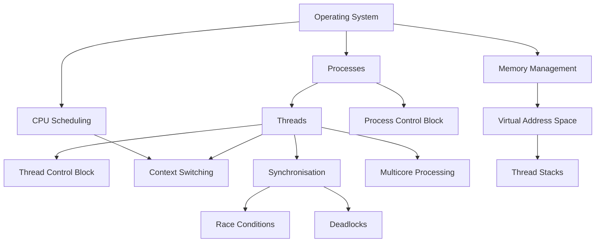

<section id="threads-practical-applications-and-revision" class="concept-section" aria-labelledby="threads-section-10-heading">

  <h2 id="threads-section-10-heading">10. Practical Applications</h2>

  <h3>10.1 Threads in Real-World Applications</h3>

  
Threads are used in many applications to help perform multiple tasks and keep software responsive.

  
Here are some practical examples.

  <h4>10.1.1 Web Browsers</h4>

  
A modern web browser may use multiple processes and threads to manage different activities.

  
Threads can help with:

  <ul>
    <li>Responding to user interactions.</li>
    <li>Processing background tasks.</li>
    <li>Handling network-related work.</li>
    <li>Updating parts of the interface.</li>
    <li>Performing other application activities.</li>
  </ul>

  
<strong>Why are threads useful?</strong>

  
They help prevent a lengthy background task from unnecessarily stopping all other application activity.

  
The exact browser architecture varies. Modern browsers often use several processes as well as multiple threads within those processes.

  <h4>10.1.2 Video Editing Applications</h4>

  
A video editing application may use threads for:

  <ul>
    <li>Processing video frames.</li>
    <li>Applying visual effects.</li>
    <li>Processing audio.</li>
    <li>Rendering previews.</li>
    <li>Exporting video.</li>
  </ul>

  
<strong>Why are threads useful?</strong>

  
Different parts of a video-processing workload may be handled concurrently. Suitable workloads can also benefit from parallel execution across multiple CPU cores.

  <h4>10.1.3 Music Applications</h4>

  
A music application may use threads to help manage:

  <ul>
    <li>Audio playback.</li>
    <li>User-interface interactions.</li>
    <li>Music downloads.</li>
    <li>Background processing.</li>
    <li>Audio decoding.</li>
  </ul>

  
<strong>Why are threads useful?</strong>

  
The application can continue responding to the user while other tasks take place.

  
Real-time audio work also has timing requirements, so thread scheduling and delays must be carefully managed.

  <h4>10.1.4 Web Servers</h4>

  
A web server may use multiple threads to handle incoming requests.

  
For example:

  <ol>
    <li>A request arrives from a user.</li>
    <li>The server assigns work to an available thread or worker.</li>
    <li>The thread processes the request.</li>
    <li>It accesses required data or services.</li>
    <li>It prepares and sends a response.</li>
  </ol>

  
Some servers use thread pools, where a group of worker threads is reused to handle multiple tasks.

  
<strong>Why are threads useful?</strong>

  
They can help a server handle multiple requests without creating a completely separate process for every task.

  <h4>10.1.5 Computer Games</h4>

  
A game may use threads for different activities, such as:

  <ul>
    <li>Game logic.</li>
    <li>Physics calculations.</li>
    <li>Audio processing.</li>
    <li>Asset loading.</li>
    <li>Background tasks.</li>
  </ul>

  
<strong>Why are threads useful?</strong>

  
They can help distribute work and maintain a responsive gaming experience.

  
However, game engines must coordinate these activities carefully because some tasks depend on the results of others.

  <h4>Practical application summary</h4>

  <table>
    <thead>
      <tr>
        <th scope="col">Application</th>
        <th scope="col">Possible thread activities</th>
      </tr>
    </thead>
    <tbody>
      <tr>
        <td>Web browser</td>
        <td>Interface, networking and background work</td>
      </tr>
      <tr>
        <td>Video editor</td>
        <td>Video, audio and rendering tasks</td>
      </tr>
      <tr>
        <td>Music application</td>
        <td>Playback, downloads and interface</td>
      </tr>
      <tr>
        <td>Web server</td>
        <td>Processing incoming requests</td>
      </tr>
      <tr>
        <td>Computer game</td>
        <td>Game logic, physics and audio</td>
      </tr>
    </tbody>
  </table>

  
These are illustrative examples. Real applications may combine threads, processes, asynchronous operations and other execution models.

  <h2 id="threads-section-11-heading">11. Common Mistakes and Misunderstandings</h2>

  
Understanding what threads are is important. Understanding what they are not is equally important.

  <h4>Mistake 1 — A Program and a Process Are the Same Thing</h4>

  
<strong>Incorrect:</strong> A program and a process are identical.

  
<strong>Correct:</strong> A program is a set of instructions. A process is an executing instance of a program, with its own process environment and resources.

  <h4>Mistake 2 — A Thread Is a Separate Process</h4>

  
<strong>Incorrect:</strong> Every thread is an independent process.

  
<strong>Correct:</strong> A thread is an execution path within a process. Threads in the same process commonly share process resources.

  <h4>Mistake 3 — Threads Have Their Own Completely Separate Memory</h4>

  
<strong>Incorrect:</strong> Every thread has its own independent copy of all process memory.

  
<strong>Correct:</strong> Threads share many process resources, including code, global data and heap memory. Each thread has its own execution context, including its stack and CPU registers.

  <h4>Mistake 4 — Concurrency Always Means Parallelism</h4>

  
<strong>Incorrect:</strong> If two tasks are concurrent, they must be executing simultaneously.

  
<strong>Correct:</strong> Concurrent tasks can make progress during overlapping periods. They may take turns on one CPU core. Parallel tasks execute simultaneously on separate processing resources.

  <h4>Mistake 5 — A Ready Thread Is Running</h4>

  
<strong>Incorrect:</strong> A thread in the Ready state is already executing.

  
<strong>Correct:</strong> It is eligible to run but is waiting for CPU time.

  <h4>Mistake 6 — More Threads Always Make a Program Faster</h4>

  
<strong>Incorrect:</strong> Adding more threads always improves performance.

  
<strong>Correct:</strong> Too many threads can increase scheduling overhead, memory use and contention. Some workloads cannot be divided efficiently.

  <h4>Mistake 7 — Shared Data Is Automatically Safe</h4>

  
<strong>Incorrect:</strong> Threads can safely modify shared data simply because they belong to the same process.

  
<strong>Correct:</strong> Shared data requires appropriate coordination. Unsynchronised access can produce race conditions.

  <h4>Mistake 8 — A Mutex Solves Every Synchronisation Problem</h4>

  
<strong>Incorrect:</strong> Using a mutex automatically makes an entire application thread-safe.

  
<strong>Correct:</strong> A mutex protects a particular critical section when used correctly. Poor locking design can still cause deadlocks, starvation or other problems.

  <h2 id="threads-section-12-heading">12. Limitations, Synchronisation and Troubleshooting</h2>

  
Threads offer important benefits, but they also introduce challenges.

  <h3>12.1 Race Conditions</h3>

  
A race condition occurs when the result of concurrent operations depends on their timing or ordering.

  
<strong>Example:</strong> Two threads attempt to update the same bank account balance.

  
If both read the same old value before either writes its update, one update may be lost.

  
<strong>Possible solution:</strong> Use appropriate synchronisation, such as a mutex or an atomic operation, depending on the data and operation involved.

  <h3>12.2 Critical Sections</h3>

  
A critical section is a part of a program that accesses shared data or resources requiring coordinated access.

  
If multiple threads modify the same shared data without suitable protection, the results may become incorrect.

  
<strong>Possible solution:</strong> Protect the critical section using an appropriate synchronisation mechanism.

  <h3>12.3 Mutexes</h3>

  
A mutex, or mutual-exclusion lock, allows one thread at a time to enter a protected critical section.

  
A simplified pattern is:

  <ol>
    <li>Acquire the mutex.</li>
    <li>Access or update the protected shared resource.</li>
    <li>Release the mutex.</li>
  </ol>

  

    
<strong>Important:</strong> All relevant accesses must follow the same locking discipline. A mutex does not protect data from code that accesses it without acquiring the lock.

  

  <h3>12.4 Semaphores</h3>

  
A semaphore is a synchronisation mechanism that uses a counter to control access to resources or coordinate activities.

  
Two common forms are:

  <ul>
    <li><strong>Binary semaphore:</strong> Uses a value representing two states, commonly 0 and 1.</li>
    <li><strong>Counting semaphore:</strong> Tracks a number of available resource permits or signals.</li>
  </ul>

  
A semaphore can be useful when a program needs to control access to a limited number of resources.

  
A semaphore and a mutex are related synchronisation tools, but they are not interchangeable in every situation. A mutex generally has ownership semantics: the thread that acquires it is expected to release it.

  <h3>12.5 Condition Variables</h3>

  
A condition variable allows threads to wait until a particular condition becomes true.

  
It is commonly used together with a mutex.

  
For example, a worker thread may wait until a queue contains work. When another thread adds an item, it can notify the waiting thread.

  
The waiting thread wakes and checks the condition again while following the required locking protocol.

  <h3>12.6 Atomic Operations</h3>

  
An atomic operation is performed as an indivisible operation from the perspective of other threads.

  
For example, an atomic counter increment can prevent the lost-update problem associated with an unsafe read-modify-write sequence.

  
Atomic operations are useful for certain shared-data problems, but they do not automatically make every multi-step operation safe.

  <h3>12.7 Deadlocks</h3>

  
A deadlock occurs when two or more threads become permanently blocked because each is waiting for a resource held by another.

  
The four classic Coffman conditions are:

  <ol>
    <li><strong>Mutual Exclusion:</strong> At least one resource cannot be shared simultaneously.</li>
    <li><strong>Hold and Wait:</strong> A thread holds one resource while waiting for another.</li>
    <li><strong>No Pre-emption:</strong> Resources cannot simply be taken away; they must be released voluntarily.</li>
    <li><strong>Circular Wait:</strong> A circular chain of threads exists, with each waiting for a resource held by the next.</li>
  </ol>

  
All four conditions must hold for a deadlock to occur under this classic model.

  
<strong>Possible prevention approaches:</strong>

  <ul>
    <li>Establish a consistent lock-acquisition order.</li>
    <li>Avoid holding locks longer than necessary.</li>
    <li>Design resource allocation carefully.</li>
    <li>Use suitable timeout or recovery strategies where appropriate.</li>
  </ul>

  <h3>12.8 Starvation</h3>

  
Starvation occurs when a thread waits for a very long time, or indefinitely, because it repeatedly fails to obtain the resources or CPU time it needs.

  
For example, a low-priority thread may continually be overlooked when higher-priority threads keep becoming eligible to run.

  
<strong>Possible approaches:</strong>

  <ul>
    <li>Fair scheduling policies.</li>
    <li>Priority adjustment or priority aging.</li>
    <li>Fair resource-access mechanisms.</li>
  </ul>

  
The effectiveness of these approaches depends on the operating system and application design.

  <h3>12.9 Thread Safety</h3>

  
Thread safety means that a component behaves correctly when accessed by multiple threads according to its intended usage rules.

  
A thread-safe component may use:

  <ul>
    <li>Mutexes.</li>
    <li>Atomic operations.</li>
    <li>Immutable data.</li>
    <li>Carefully designed concurrent data structures.</li>
    <li>Other synchronisation techniques.</li>
  </ul>

  
Thread safety is a property of the implementation and its usage, not simply a result of using multiple threads.

  <h3>12.10 Overhead and Resource Contention</h3>

  
Threads are not free.

  
They may require:

  <ul>
    <li>Memory for stacks and management information.</li>
    <li>Scheduling and context-switching work.</li>
    <li>Synchronisation operations.</li>
    <li>Coordination between CPU cores.</li>
  </ul>

  
Too many threads competing for the same CPU, memory or locks can reduce performance.

  <h3>12.11 Troubleshooting Guide</h3>

  <table>
    <thead>
      <tr>
        <th scope="col">Problem</th>
        <th scope="col">Possible reason</th>
        <th scope="col">What to investigate</th>
      </tr>
    </thead>
    <tbody>
      <tr>
        <td>Incorrect shared-data results</td>
        <td>Race condition</td>
        <td>Check concurrent reads and writes</td>
      </tr>
      <tr>
        <td>Application becomes unresponsive</td>
        <td>Blocked thread or long-running work</td>
        <td>Identify what the thread is waiting for</td>
      </tr>
      <tr>
        <td>Threads remain waiting indefinitely</td>
        <td>Deadlock</td>
        <td>Examine lock ownership and acquisition order</td>
      </tr>
      <tr>
        <td>One thread rarely makes progress</td>
        <td>Starvation</td>
        <td>Examine scheduling and resource fairness</td>
      </tr>
      <tr>
        <td>Performance becomes slower</td>
        <td>Too many threads or contention</td>
        <td>Review workload and thread count</td>
      </tr>
      <tr>
        <td>Unexpected data changes</td>
        <td>Missing synchronisation</td>
        <td>Check all accesses to shared data</td>
      </tr>
      <tr>
        <td>High CPU usage</td>
        <td>Busy waiting or excessive work</td>
        <td>Examine loops, scheduling and workload</td>
      </tr>
    </tbody>
  </table>

  

    
<strong>Remember:</strong> Adding threads introduces coordination responsibilities. Correct synchronisation and careful design are essential.

  

  <h2 id="threads-section-13-heading">13. Connections to Other Operating-System Concepts</h2>

  
Threads are closely connected to several other operating-system topics.

  
Understanding these relationships helps build a complete picture of how an operating system manages execution.

  <h3>13.1 Operating Systems</h3>

  
The operating system manages processes, threads, memory, devices and other resources.

  
Threads are one of the mechanisms through which programs perform work.

  <h3>13.2 Programs</h3>

  
A program contains instructions.

  
When a program is executed, the operating system creates or manages an execution environment in which processes and threads can operate.

  <h3>13.3 Processes</h3>

  
A process is an executing program instance with its own resource environment.

  
A process can contain one or more threads.

  
Threads within the same process commonly share many resources.

  <h3>13.4 Process Control Block (PCB)</h3>

  
A Process Control Block is a conceptual operating-system data structure containing information used to manage a process.

  
Depending on the operating system, this may include process identification, state, resource and memory-management information.

  <h3>13.5 Thread Control Block (TCB)</h3>

  
A Thread Control Block is a conceptual term for information maintained to manage an individual thread.

  
It may represent information such as thread state, scheduling information and execution context.

  
The exact names and structures vary between operating systems.

  <h3>13.6 CPU Scheduling</h3>

  
CPU scheduling determines which eligible thread or execution entity should receive CPU time.

  
The scheduler helps share processing resources among competing work.

  <h3>13.7 Context Switching</h3>

  
Context switching allows CPU execution to move from one thread to another.

  
The necessary execution context is saved and restored so that threads can resume their work.

  <h3>13.8 Memory Management</h3>

  
Threads share many parts of their process’s virtual address space.

  
Each thread also requires its own stack and execution context.

  
Memory management therefore plays an important role in supporting multithreaded processes.

  <h3>13.9 Synchronisation</h3>

  
Synchronisation coordinates access to shared resources and helps ensure that concurrent operations produce correct results.

  
Mutexes, semaphores, condition variables and atomic operations are examples of related mechanisms.

  <h3>13.10 Race Conditions</h3>

  
Race conditions demonstrate why shared-data access must be designed carefully.

  
They connect thread management with synchronisation, critical sections and thread safety.

  <h3>13.11 Deadlocks</h3>

  
Deadlocks can arise when threads wait for resources held by one another.

  
They connect thread synchronisation with resource allocation and operating-system resource management.

  <h3>13.12 Multicore Processing</h3>

  
A multicore processor contains multiple CPU cores.

  
Suitable threads may execute simultaneously on different cores, allowing parallel processing.

  <h4>Related concept map</h4>

  <h4>Concept connection summary</h4>

  
Threads connect multiple important areas of operating systems:

  <ul>
    <li>Process management explains where threads belong.</li>
    <li>Scheduling explains how they receive CPU time.</li>
    <li>Context switching explains how execution moves between them.</li>
    <li>Memory management explains shared address spaces and individual stacks.</li>
    <li>Synchronisation explains how threads coordinate.</li>
    <li>Deadlock and race-condition concepts explain what can go wrong.</li>
    <li>Multicore processing explains how parallel execution can occur.</li>
  </ul>

  <h2 id="threads-section-14-heading">14. Assessment — Test Your Understanding</h2>

  

    This assessment contains twelve questions designed to test your understanding
    of threads in an operating system. The questions progress from fundamental
    definitions to practical situations involving scheduling, concurrency,
    synchronisation and performance.
  

  

    Read each question carefully and select the best answer. When you are ready,
    press the reveal control below that question to check the correct answer
    and read its explanation.
  

  <h4>Question 1 — What is a thread?</h4>

  <ol type="A">
    <li>A complete program stored on a storage device.</li>
    <li>A path of execution within a process.</li>
    <li>A physical processor inside the computer.</li>
    <li>A separate operating system.</li>
  </ol>

  

    
Reveal answer and explanation

    

      
<strong>Correct answer: B</strong>

      
<strong>Explanation:</strong> A thread is a unit of execution within a process. It represents a sequence of instructions that the CPU can execute. A process can contain one or multiple threads.

    

  

  <h4>Question 2 — Which resources are commonly shared by threads belonging to the same process?</h4>

  <ol type="A">
    <li>Their individual program counters and CPU registers.</li>
    <li>Their individual stacks and execution states.</li>
    <li>The process's code, global data and heap memory.</li>
    <li>A separate copy of the entire process for every thread.</li>
  </ol>

  

    
Reveal answer and explanation

    

      
<strong>Correct answer: C</strong>

      
<strong>Explanation:</strong> Threads within the same process commonly share its code, global data, heap memory and other process resources. Each thread nevertheless maintains its own execution context, including its stack, program counter and CPU registers.

    

  

  <h4>Question 3 — Why does each thread need its own program counter and stack?</h4>

  <ol type="A">
    <li>Because every thread must run a different operating system.</li>
    <li>Because each thread must remember its own execution position and function calls.</li>
    <li>Because threads cannot share process memory.</li>
    <li>Because each thread must have a separate physical CPU.</li>
  </ol>

  

    
Reveal answer and explanation

    

      
<strong>Correct answer: B</strong>

      
<strong>Explanation:</strong> The program counter records the next instruction for a thread to execute. Its stack maintains information such as function calls, local variables and return addresses. These individual resources allow threads to follow different execution paths within the same process.

    

  

  <h4>Question 4 — A thread is Ready. What does this mean?</h4>

  <ol type="A">
    <li>It has finished executing.</li>
    <li>It is waiting for an event and cannot execute.</li>
    <li>It is prepared to execute but is waiting to be allocated CPU time.</li>
    <li>It has been permanently removed from the process.</li>
  </ol>

  

    
Reveal answer and explanation

    

      
<strong>Correct answer: C</strong>

      
<strong>Explanation:</strong> A Ready thread has everything it needs to run except access to a CPU. It waits in a ready queue until the scheduler selects it for execution.

    

  

  <h4>Question 5 — What is the difference between concurrency and parallelism?</h4>

  <ol type="A">
    <li>They both mean that every task must execute on a different computer.</li>
    <li>Concurrency means tasks make progress over overlapping periods; parallelism means tasks execute simultaneously.</li>
    <li>Concurrency requires multiple CPU cores, while parallelism requires only one.</li>
    <li>They are two different names for a blocked thread.</li>
  </ol>

  

    
Reveal answer and explanation

    

      
<strong>Correct answer: B</strong>

      
<strong>Explanation:</strong> Concurrency is about managing multiple tasks that make progress during overlapping periods. On a single CPU core, the operating system can switch between threads. Parallelism involves actual simultaneous execution using multiple processing resources, such as separate CPU cores.

    

  

  <h4>Question 6 — A computer has one CPU core and three Ready threads. How can all three threads make progress?</h4>

  <ol type="A">
    <li>The single core executes all three threads at exactly the same instant.</li>
    <li>The operating system schedules them to take turns using CPU time.</li>
    <li>The threads automatically create two additional CPU cores.</li>
    <li>The operating system must terminate two of the threads.</li>
  </ol>

  

    
Reveal answer and explanation

    

      
<strong>Correct answer: B</strong>

      
<strong>Explanation:</strong> A single CPU core can execute one thread at a time. The scheduler can rapidly switch between Ready threads, allowing each to make progress. This is an example of concurrency, not simultaneous parallel execution.

    

  

  <h4>Question 7 — Two threads update the same bank account balance. Both read $100, independently calculate a new balance of $110 and then write their results. What problem might occur?</h4>

  <ol type="A">
    <li>A context switch.</li>
    <li>A race condition that may cause a lost update.</li>
    <li>A successful deadlock prevention mechanism.</li>
    <li>A memory allocation failure.</li>
  </ol>

  

    
Reveal answer and explanation

    

      
<strong>Correct answer: B</strong>

      
<strong>Explanation:</strong> Both threads may read the same original value before either update is written. One update can overwrite the other, leaving the balance at $110 instead of the expected $120. The result depends on the timing and ordering of concurrent operations.

    

  

  <h4>Question 8 — What is the main purpose of a mutex?</h4>

  <ol type="A">
    <li>To give every thread its own CPU core.</li>
    <li>To create a new process.</li>
    <li>To provide mutual exclusion when accessing a protected critical section.</li>
    <li>To increase the amount of physical memory.</li>
  </ol>

  

    
Reveal answer and explanation

    

      
<strong>Correct answer: C</strong>

      
<strong>Explanation:</strong> A mutex is a synchronisation mechanism that allows only one thread at a time to hold the lock and enter the protected critical section. When threads follow the same locking discipline, it helps prevent conflicting access to shared data.

    

  

  <h4>Question 9 — What happens during a thread context switch?</h4>

  <ol type="A">
    <li>The entire operating system is restarted.</li>
    <li>The current thread's execution context is saved and another thread's context is restored.</li>
    <li>The current process is always deleted.</li>
    <li>All shared memory is erased.</li>
  </ol>

  

    
Reveal answer and explanation

    

      
<strong>Correct answer: B</strong>

      
<strong>Explanation:</strong> During a context switch, the operating system preserves the necessary execution information of the thread being paused and restores the information needed by the next thread. This allows each thread to resume its work later.

    

  

  <h4>Question 10 — Thread A holds Resource 1 and waits for Resource 2. Thread B holds Resource 2 and waits for Resource 1. What situation does this describe?</h4>

  <ol type="A">
    <li>Normal parallel execution.</li>
    <li>Starvation-free scheduling.</li>
    <li>Deadlock.</li>
    <li>Successful thread termination.</li>
  </ol>

  

    
Reveal answer and explanation

    

      
<strong>Correct answer: C</strong>

      
<strong>Explanation:</strong> Each thread is waiting for a resource held by the other. Neither can proceed or release the resource it already holds. This circular waiting situation is a deadlock.

    

  

  <h4>Question 11 — A web browser uses separate threads for handling user input, loading web content and playing media. What is a major benefit of this design?</h4>

  <ol type="A">
    <li>It guarantees that the browser will never encounter an error.</li>
    <li>It allows different activities to make progress independently, improving responsiveness.</li>
    <li>It guarantees that every activity executes on a separate physical CPU.</li>
    <li>It removes the need for memory management.</li>
  </ol>

  

    
Reveal answer and explanation

    

      
<strong>Correct answer: B</strong>

      
<strong>Explanation:</strong> Separating activities into threads can help a browser remain responsive while other work continues. For example, the user interface may remain available while a page loads. The operating system schedules the threads, and they may execute concurrently or in parallel depending on available processing resources.

    

  

  <h4>Question 12 — Does increasing the number of threads always make a program faster?</h4>

  <ol type="A">
    <li>Yes. Every additional thread automatically receives a separate CPU core.</li>
    <li>Yes. More threads always reduce the amount of work performed.</li>
    <li>No. Scheduling overhead, resource contention and synchronisation can reduce performance.</li>
    <li>No. Operating systems cannot execute more than one thread per process.</li>
  </ol>

  

    
Reveal answer and explanation

    

      
<strong>Correct answer: C</strong>

      
<strong>Explanation:</strong> Threads can improve responsiveness and performance, but creating too many threads can increase scheduling and context-switching overhead. Threads may also compete for shared resources or spend time waiting for locks. Effective thread design depends on the workload and available hardware.

    

  

  <h4>Assessment Reflection</h4>

  

    After answering the questions, review any explanations that you found
    difficult. Pay particular attention to the distinction between processes
    and threads, concurrency and parallelism, and the problems caused by
    unsynchronised access to shared data.
  

  

    Understanding these relationships will help you connect threads to CPU
    scheduling, memory management, synchronisation and the wider architecture
    of an operating system.
  

  
  <h2 id="threads-section-15-heading">15. Quick Revision — Threads at a Glance</h2>

  

    This section brings together the most important ideas from the Threads
    concept. Use these revision cards to revisit the definitions, architecture,
    lifecycle, scheduling, concurrency, synchronisation and practical
    applications covered throughout this lesson.
  

  

    <h3>Thread Foundations</h3>

    <h4>What is a thread?</h4>

    

      A thread is a path of execution within a process. It represents a sequence
      of instructions that can be scheduled by the operating system to use CPU time.
    

    <h4>What does a process provide?</h4>

    

      A process provides the resource environment in which its threads operate.
      This includes the process's address space, code, data, heap and other
      associated resources.
    

    <h4>What do threads in the same process share?</h4>

    
Threads commonly share:

    <ul>
      <li>Program code.</li>
      <li>Global and static data.</li>
      <li>Heap memory.</li>
      <li>Open files and other process-associated resources.</li>
    </ul>

    <h4>What does each thread maintain independently?</h4>

    <ul>
      <li>Thread identifier (Thread ID).</li>
      <li>Program counter.</li>
      <li>CPU registers and execution context.</li>
      <li>Its own stack.</li>
      <li>Thread execution state.</li>
      <li>Thread-local storage, where supported.</li>
    </ul>

  

  

    <h3>Thread Lifecycle and CPU Execution</h3>

    <h4>What are the main thread lifecycle states?</h4>

    <ul>
      <li><strong>New:</strong> The thread is being created.</li>
      <li><strong>Ready:</strong> The thread is eligible to execute and waiting for CPU time.</li>
      <li><strong>Running:</strong> The thread is currently executing on a CPU.</li>
      <li><strong>Blocked/Waiting:</strong> The thread is waiting for an event, resource or operation to complete.</li>
      <li><strong>Terminated:</strong> The thread has finished execution.</li>
    </ul>

    

      These are the conceptual lifecycle states used in this lesson. Actual
      operating systems may use different state names and more detailed state
      transitions.
    

    <h4>What is thread scheduling?</h4>

    

      Thread scheduling is the process of selecting an eligible thread to receive
      CPU time. The operating system's scheduler manages which thread runs and
      when it runs.
    

    <h4>What is a context switch?</h4>

    

      A context switch occurs when CPU execution moves from one thread to another.
      The necessary execution information of the current thread is saved, and the
      execution information of the next thread is restored.
    

  

  

    <h3>Concurrency and Parallelism</h3>

    <h4>What is concurrency?</h4>

    

      Concurrency means multiple tasks can make progress during overlapping
      periods. On a single CPU core, the operating system can achieve this by
      switching between threads.
    

    <h4>What is parallelism?</h4>

    

      Parallelism means multiple tasks execute simultaneously using separate
      processing resources, such as multiple CPU cores.
    

  

  

    <h3>Synchronisation and Multithreading Challenges</h3>

    <h4>What is a race condition?</h4>

    

      A race condition occurs when the result of concurrent operations depends
      on their timing or ordering. It can cause incorrect results when threads
      access shared data without appropriate coordination.
    

    <h4>What is a critical section?</h4>

    

      A critical section is a part of a program that accesses shared data or
      resources and must be protected against conflicting concurrent access.
    

    <h4>What is synchronisation?</h4>

    

      Synchronisation coordinates threads so that their operations occur safely
      and in the required order when they share resources.
    

    <h4>What is a mutex?</h4>

    

      A mutex is a mutual-exclusion mechanism that allows one thread at a time
      to hold a lock protecting a critical section.
    

    <h4>What is a semaphore?</h4>

    

      A semaphore is a synchronisation mechanism that uses a counter to control
      access to resources or coordinate activities between threads.
    

    <h4>What is a deadlock?</h4>

    

      A deadlock occurs when threads cannot proceed because they are waiting
      for resources held by one another, creating a circular waiting situation.
    

    <h4>What is starvation?</h4>

    

      Starvation occurs when a thread waits indefinitely or for an excessively
      long time because it repeatedly fails to receive the resources or CPU
      opportunity it needs.
    

  

  

    <h3>Practical Value and Performance</h3>

    <h4>Why are threads useful?</h4>

    <ul>
      <li>They can improve application responsiveness.</li>
      <li>They allow different activities within one process to make progress independently.</li>
      <li>They can support parallel execution on multicore processors.</li>
      <li>They allow multiple tasks to share process resources.</li>
      <li>They are useful in browsers, servers, games, multimedia applications and many other systems.</li>
    </ul>

    <h4>What are the main challenges of multithreading?</h4>

    <ul>
      <li>Race conditions and lost updates.</li>
      <li>Deadlocks and starvation.</li>
      <li>Complex synchronisation requirements.</li>
      <li>Competition for shared resources.</li>
      <li>Scheduling and context-switching overhead.</li>
      <li>Difficulty testing and debugging concurrent behaviour.</li>
    </ul>

  

  

    <h3>Final Memory Model</h3>

    <ul>
      <li>One process can contain one or multiple threads.</li>
      <li>Threads share many process resources.</li>
      <li>Each thread maintains its own execution context and stack.</li>
      <li>The scheduler manages access to CPU time.</li>
      <li>Concurrency allows overlapping progress; parallelism allows simultaneous execution.</li>
      <li>Synchronisation helps protect shared resources and coordinate execution.</li>
      <li>Good thread design balances responsiveness, correctness and performance.</li>
    </ul>

  

  <h3>15.1 Final Learning Reflection</h3>

  

    You have explored threads progressively, beginning with simple explanations
    and analogies before moving into their technical structure and behaviour
    inside an operating system.
  

  

    You have learned how threads relate to processes, how they share resources,
    how their individual execution contexts are maintained, and how the
    operating system manages their lifecycle and CPU scheduling.
  

  

    You have also explored concurrency, parallelism, multicore processing,
    context switching and the synchronisation mechanisms used to coordinate
    access to shared resources. Through practical examples and interactive
    simulations, you have seen how race conditions, mutexes and deadlocks
    affect multithreaded programs.
  

  

    These ideas provide a foundation for understanding more advanced operating
    system topics, including CPU scheduling, process management, memory
    management, concurrency control and multicore architecture.
  

  

    
<strong>The most important idea to remember:</strong>

    

      A thread is an independent path of execution within a process. Threads
      can share resources and cooperate, but their execution must be scheduled
      and coordinated carefully to ensure correct, reliable and efficient
      behaviour.
    

  

</section>
