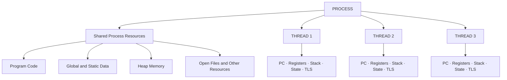
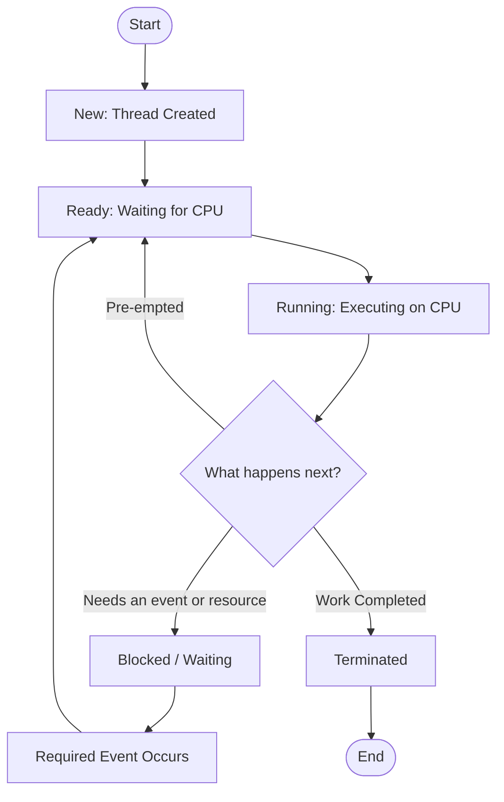
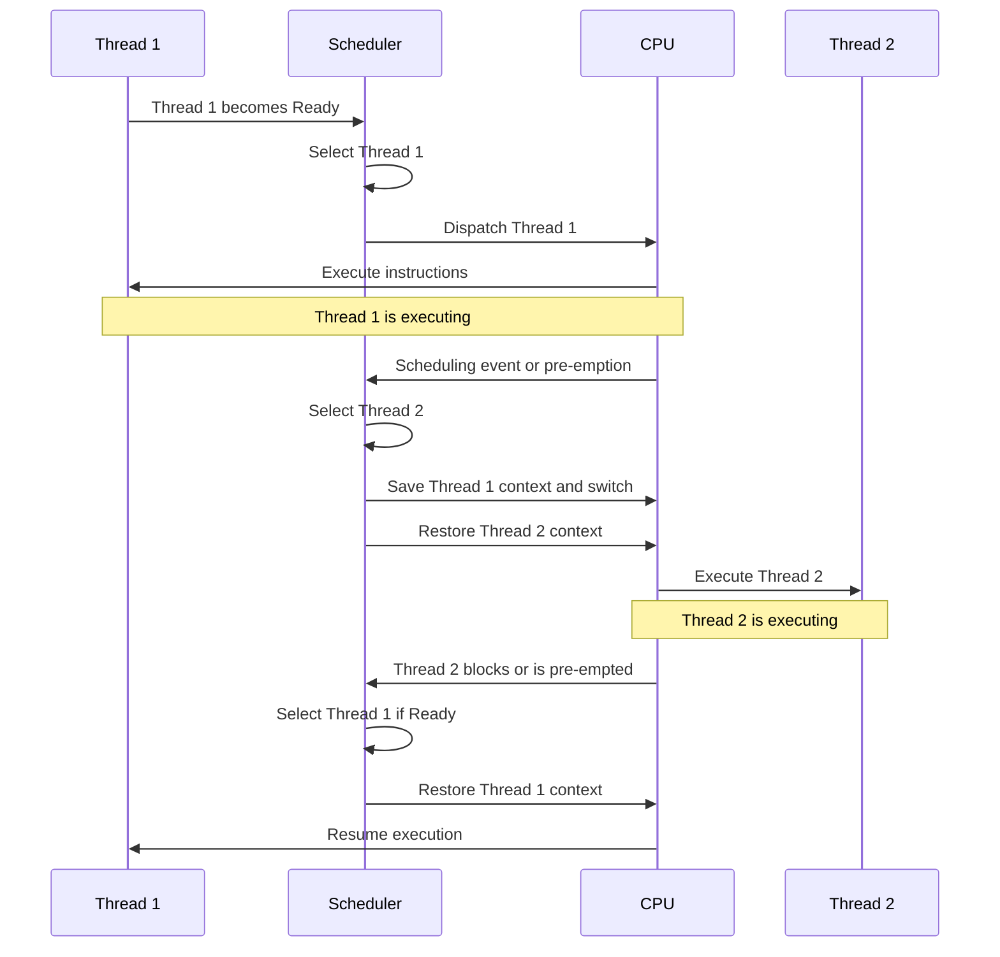
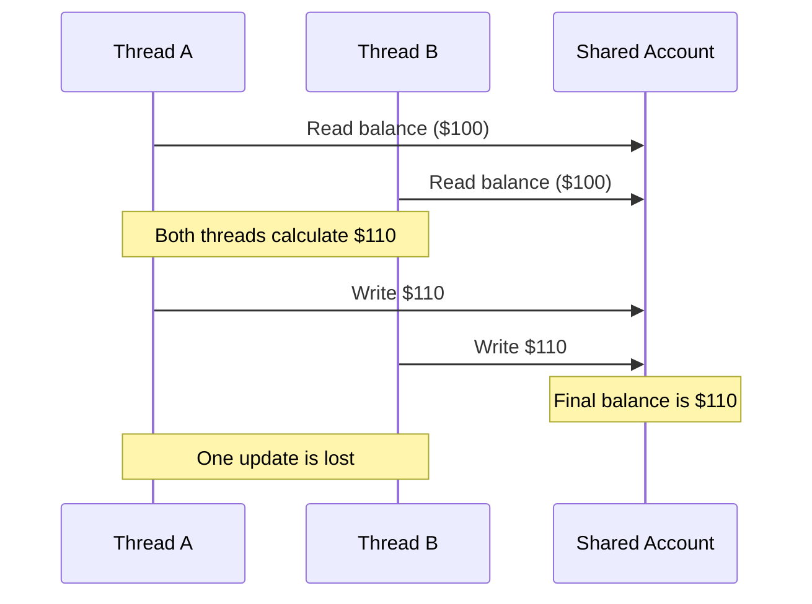
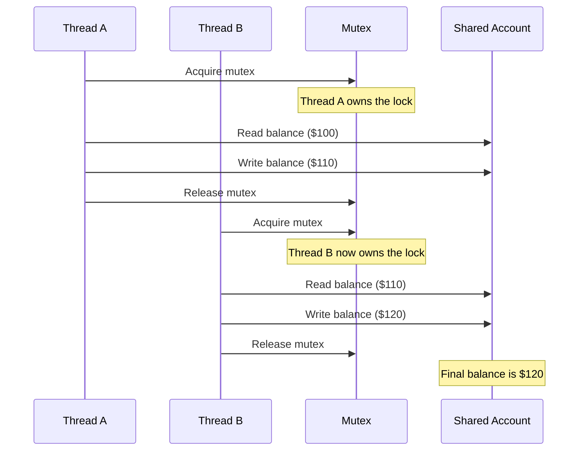

<section id="threads-diagrams" class="concept-section" aria-labelledby="threads-section-9-heading">

  <h2 id="threads-section-9-heading">9. Thread Lifecycle, Flowcharts and Sequence Diagrams</h2>

  <h3>9.1 Why Use Diagrams to Understand Threads?</h3>

  
Threads involve several components and activities working together.

  
Text explains what happens, but diagrams help us visualise:

  <ul>
    <li>How threads relate to their parent process.</li>
    <li>How a thread moves between lifecycle states.</li>
    <li>How the scheduler and CPU cooperate.</li>
    <li>How race conditions occur when threads access shared data.</li>
    <li>How synchronisation helps protect shared resources.</li>
  </ul>

  
This section introduces four diagrams.

  <h3>9.2 Diagram 1 — Process and Thread Architecture</h3>

  <h4>Understanding the relationship</h4>

  
A process provides a shared environment for its threads.

  
Threads belonging to the same process commonly share program code, global and static data, heap memory and process-associated resources.

  
Each thread maintains its own execution context.

  <h4>Conceptual architecture diagram</h4>

  <h4>How to understand the diagram</h4>

  <ol>
    <li>The process is the overall resource environment.</li>
    <li>The shared resources are available to threads belonging to that process, subject to access and synchronisation rules.</li>
    <li>Each thread has its own program counter, CPU registers, stack, state and thread-local storage.</li>
    <li>The threads are separate execution paths operating within the same process.</li>
  </ol>

  

    <h4>Important distinction</h4>
    
Sharing a process does not mean that threads share everything.

    
They share many process resources, but they maintain separate execution contexts.

  

  <h3>9.3 Diagram 2 — Thread Lifecycle Flowchart</h3>

  <h4>Understanding the lifecycle</h4>

  
A thread moves through different states during its lifetime.

  
The following flowchart illustrates a simplified lifecycle, including creation, execution, waiting, resuming and termination.

  <h4>Thread lifecycle flowchart</h4>

  <h4>Step-by-step explanation</h4>

  <ol>
    <li><strong>New:</strong> A thread is created.</li>
    <li><strong>Ready:</strong> It is eligible to run but is waiting for CPU time.</li>
    <li><strong>Running:</strong> The scheduler selects it and it executes.</li>
    <li><strong>Blocked/Waiting:</strong> It cannot continue until a required event or condition occurs.</li>
    <li><strong>Ready again:</strong> Once the event occurs, it becomes eligible for CPU time.</li>
    <li><strong>Terminated:</strong> It completes its work or is stopped.</li>
  </ol>

  <h4>Understanding pre-emption</h4>

  
A running thread may be pre-empted before it finishes.

  
It returns to the Ready state so that another eligible thread can receive CPU time.

  
A context switch may occur when execution moves to another thread.

  

    <h4>Important distinction</h4>
    
A thread becoming Ready does not mean it immediately starts Running.

    
The scheduler must select it.

  

  <h3>9.4 Diagram 3 — Thread Scheduling Sequence Diagram</h3>

  <h4>Understanding scheduling</h4>

  
A sequence diagram shows how different parts of a system interact over time.

  
Here we examine a simplified example involving:

  <ul>
    <li>Thread 1.</li>
    <li>Thread 2.</li>
    <li>The operating-system scheduler.</li>
    <li>The CPU.</li>
  </ul>

  <h4>Thread scheduling sequence</h4>

  <h4>How to read the sequence</h4>

  <ol>
    <li>Thread 1 becomes Ready.</li>
    <li>The scheduler selects Thread 1.</li>
    <li>The CPU begins executing Thread 1.</li>
    <li>A scheduling event causes execution to move away from Thread 1.</li>
    <li>The scheduler selects Thread 2.</li>
    <li>The required execution context is saved and restored.</li>
    <li>Thread 2 begins executing.</li>
    <li>When another scheduling event occurs, Thread 1 may resume if it is Ready and selected.</li>
  </ol>

  <h4>What is a context switch?</h4>

  
A context switch is the process of preserving the execution context of one thread and restoring the context of another when CPU execution changes.

  
The saved information allows a thread to resume its work later.

  

    <h4>Important distinction</h4>
    
<strong>Scheduling</strong> is the decision about which thread should run.

    
<strong>Context switching</strong> is the mechanism that allows CPU execution to move between threads.

  

  
The diagram is a simplified teaching sequence. Actual operating systems may involve additional components and more complex scheduling events.

  <h3>9.5 Diagram 4 — Race Condition and Synchronisation Sequence</h3>

  <h4>Understanding the problem</h4>

  
Threads may share data inside a process.

  
If two threads access and modify the same data without suitable coordination, their operations can interfere with one another.

  
This can produce a race condition.

  
We will use a shared bank account to demonstrate the problem.

  
<strong>Starting balance: $100</strong>

  
Two threads each attempt to deposit $10.

  <h4>Scenario A — Without a Mutex</h4>

  
The deposit is assumed to use separate read, calculate and write operations.

  <h4>Race condition sequence</h4>

  <h4>What happened?</h4>

  <ol>
    <li>Thread A reads $100.</li>
    <li>Thread B also reads $100.</li>
    <li>Both calculate a new balance of $110.</li>
    <li>Thread A writes $110.</li>
    <li>Thread B writes $110.</li>
    <li>The final balance remains $110.</li>
  </ol>

  
The intended final balance was $120.

  
One deposit was lost because the operations interfered with one another.

  
This is a race condition caused by an unsafe read-modify-write sequence.

  <h4>Scenario B — With a Mutex</h4>

  
A mutex protects the critical section so that only one thread at a time can perform the protected update.

  <h4>Synchronisation sequence</h4>

  <h4>What changed?</h4>

  <ol>
    <li>Thread A acquires the mutex.</li>
    <li>Thread A performs the protected update.</li>
    <li>Thread A releases the mutex.</li>
    <li>Thread B acquires the mutex.</li>
    <li>Thread B reads the updated balance.</li>
    <li>Thread B performs its update.</li>
    <li>Thread B releases the mutex.</li>
    <li>The final balance is $120.</li>
  </ol>

  
Both deposits are included.

  

    <h4>Important learning point</h4>
    
A mutex provides mutual exclusion for a protected critical section.

    
It works correctly only when all relevant accesses follow the same locking discipline.

    
A mutex does not automatically make every part of an application thread-safe.

  

  <h3>9.6 Compare the Four Diagrams</h3>

  <table>
    <thead>
      <tr>
        <th scope="col">Diagram</th>
        <th scope="col">What it teaches</th>
      </tr>
    </thead>
    <tbody>
      <tr>
        <td>Process and Thread Architecture</td>
        <td>What threads share and what remains individual</td>
      </tr>
      <tr>
        <td>Thread Lifecycle Flowchart</td>
        <td>How a thread changes state</td>
      </tr>
      <tr>
        <td>Scheduling Sequence Diagram</td>
        <td>How scheduling and context switching work</td>
      </tr>
      <tr>
        <td>Race Condition Sequence</td>
        <td>Why synchronisation is needed for shared data</td>
      </tr>
    </tbody>
  </table>

  
Each diagram explains a different aspect of multithreading.

  
Together, they provide a broader understanding of how threads are organised, executed and coordinated.

  <h3>9.7 Quick Revision</h3>

  
Remember these four ideas:

  <ol>
    <li><strong>Architecture:</strong> Threads share many process resources but have individual execution contexts.</li>
    <li><strong>Lifecycle:</strong> Threads move between states such as Ready, Running and Blocked/Waiting.</li>
    <li><strong>Scheduling:</strong> The scheduler selects eligible threads, while context switching allows execution to move between them.</li>
    <li><strong>Synchronisation:</strong> Mutexes can protect critical sections and help prevent unsafe concurrent updates.</li>
  </ol>

  

    
<strong>Final takeaway:</strong> Understanding threads requires understanding both their individual execution paths and the shared environment in which they operate.

  

</section>
